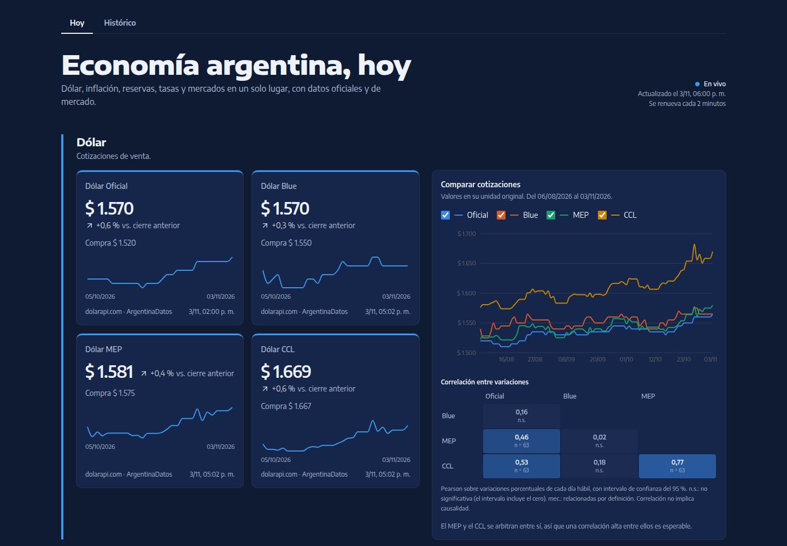
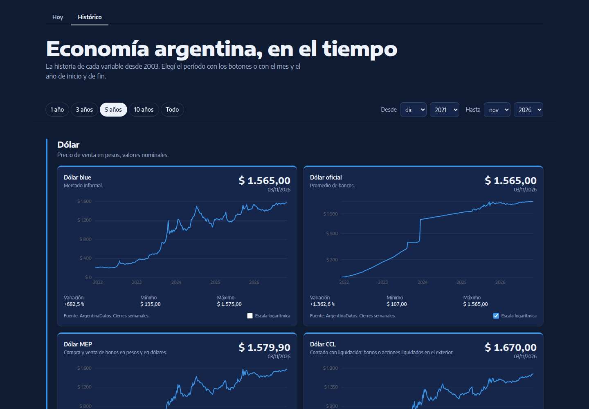

# Argentina economic dashboard

A fast, public dashboard of Argentina's economy: the dollar in all its flavours, inflation, reserves, rates and markets, from official and market sources. No database, no keys, no sign-up.

The UI is in Spanish (`es-AR`).




## Quick start

Requires Node 24 and pnpm.

```bash
pnpm install
pnpm dev            # http://localhost:3000
```

| Command | What it does |
|---------|--------------|
| `pnpm dev` | Development server |
| `pnpm build && pnpm start` | Production build and server |
| `pnpm test` | Unit tests (parsers, statistics, history windows) |
| `pnpm lint` | ESLint |

No environment variables are needed: every source is a free, public API.

## What's inside

### Hoy: today's numbers

| Section | Indicators |
|---------|------------|
| Dólar | Oficial, blue, MEP, CCL |
| Presión cambiaria | CCL vs. oficial gap, wholesale rate (A3500) inside the exchange-rate band, crypto dollar (USDT) |
| Inflación | Monthly, year-on-year, expected in 12 months (REM median) |
| Actividad económica | GDP month by month (INDEC's EMAE): year-on-year and seasonally adjusted monthly change |
| Dinero y crédito | Reserves, monetary base, private M2, deposits, private-sector loans |
| Tasas | 30-day term deposit, TAMAR, BADLAR, personal loans, overdrafts, real rate |
| Mercados | Country risk, Merval in pesos and in CCL dollars |
| Índices | UVA, CER, ICL |

The hot indicators refresh every 2 minutes in the browser. Each section ends with a comparison panel: a chart with selectable series (level, base 100 or change, depending on what the section measures) and a correlation matrix with 95 % confidence intervals.

Dragging across a comparison chart with the mouse zooms into those dates and the Y axis refits to them; **Restablecer zoom** or a double click goes back. The correlations keep using every loaded point.

### Panel: the whole economy on one screen

A dense, full-width dashboard in the style of a BI report: ten key indicators with their latest value, change over the period and a sparkline, a large chart of the selected indicator, and eight topic charts (dollars, gap, rates vs. inflation, activity, monthly inflation, country risk, reserves).

- One period filter drives every number and chart, and lives in the URL like on Histórico.
- Clicking an indicator shows it in the large chart.
- Every chart plots the close of each month, so daily and monthly series share one axis: hovering a month on any chart shows that month on all of them.
- Dragging across any chart zooms every chart to the same months, with each Y axis refitted; on touch screens, the slider under the large chart does the same. The indicator cards keep showing the whole period.

### Histórico: the series over time



One line chart per variable (dollars, gap, inflation, economic activity, country risk, reserves, BADLAR) since 2003, with presets (1, 3, 5, 10 years, all) or any month-to-month range. The range lives in the URL, so every view can be shared.

- Long ranges show weekly or monthly closes; min, max and change are computed on every point.
- Price-level series can switch to a log axis per chart; it is off by default.
- Each chart zooms on its own: drag across it with the mouse, or move the slider under it (it works with a finger too). The axes and marks refit to the visible dates, and min, max and change keep describing the whole period. Double click or **Restablecer zoom** goes back; changing the period clears the zoom.
- On phones, touch never zooms a chart, so scrolling and pinch-zooming the page work as usual.
- **Exportar video** downloads a 10-second 1920×1080 animation of the chart as shown, with its window, scale and marks: the line draws itself with a bubble on its latest value, and value labels stay on the start of each period. It is recorded in the browser (MP4 where supported, WebM otherwise), so keep the tab visible while it records.
- Optional marks add context to every chart and can be combined. The first layer, **Presidencias**, shades each presidential term from its inauguration day and names the president in the tooltip. Active layers are kept in the URL (`?marcas=presidencias`).

### Mapas: where things happen

One navigable map of Argentina (MapLibre on OpenFreeMap's light basemap) with a KPI selector, its value variants and a period selector that starts at the latest data. KPI, value and period live in the URL (`?kpi=pobreza&valor=hogares&periodo=2026-s1`; employment is `?kpi=empleo`, with `valor=variacion` by default or `valor=puestos`; exports are `?kpi=exportaciones`, with `valor=total` by default or `valor=variacion`; the census is `?kpi=censo`, with `valor=poblacion` by default or `valor=densidad`).

| KPI | Drawn on | Periods |
|-----|----------|---------|
| Average registered private wage (OEDE) | Provinces; Buenos Aires split into the 24 GBA partidos and the rest | Monthly; June and December include the aguinaldo |
| Registered private employment, year-on-year % change or number of jobs (OEDE) | Provinces, split like the wages | Quarterly |
| Private deposits and loans, millions of pesos or loans as % of deposits (BCRA) | Provinces, split like the wages (the BCRA splits Buenos Aires itself) | Quarterly |
| Poverty and indigence, % of persons or households (INDEC, EPH) | The 31 EPH urban areas as points | Half-yearly |
| Inflation, monthly and year-on-year (INDEC) | The 6 INDEC regions | Monthly |
| Unemployment rate (INDEC, EPH) | The 31 EPH urban areas as points | Quarterly |
| Activity and employment rates (INDEC, EPH) | The 31 EPH urban areas as points | Quarterly |
| Exports of goods, millions of USD or year-on-year % change (INDEC, OPEX) | Provinces; INDEC reports Buenos Aires as one province, so both of its halves show the same total | First half of each year (provisional for the latest years) |
| Census 2022: population and density, inhabitants per km² (INDEC) | The 527 departments, partidos and comunas | Fixed (2022) |

- Each value is shown where its source measures it: INDEC publishes poverty and the labor rates only for urban areas, never by province, so they are points. Survey estimates with a coefficient of variation above 16 % carry a "usar con cuidado" mark.
- INDEC publishes exports by province of origin per half-year (the first half in September, the full year in March); the map uses the first half of each year so the year-on-year change compares like with like. Exports with an undetermined origin, from abroad or from the continental shelf are left out. The data are a committed snapshot of INDEC's legacy `.xls` annex: refresh it with `node --disable-warning=MODULE_TYPELESS_PACKAGE_JSON scripts/maps/opex-snapshot.mts` (needs LibreOffice).
- OEDE publishes provincial employment per quarter, not per month, in a workbook with one sheet per province; the map reads the TOTAL row of each and computes the year-on-year change itself.
- Deposits and loans (`?kpi=depositos`, with `valor=depositos` by default, `valor=prestamos` or `valor=relacion`, loans as % of deposits) come from the BCRA's `vol4_ser.txt` "Información por provincia" file, read at runtime. It has no labels, so the parser checks its layout against the data (the provinces must add up to the national total) and fails instead of mislabelling. Balances belong to the province of the bank branch, not of the depositor. The BCRA already splits Buenos Aires into Gran Buenos Aires and the rest of the province, so no total is split by guesswork. Peso amounts label as "$ 98,2 B" (billones, 10^12) or "$ 12,3 mil M" (mil millones).
- The census map has no NBI (unmet basic needs) variant: INDEC publishes no NBI table by department for the 2022 census. Density uses the area INDEC publishes for each department. The Antarctic sector and the South Atlantic islands (INDEC's department 94028, 81 people at Antarctic bases) are not drawn, like in the other maps. The department shapes (`public/geo/departments.json`) load only when the census is selected.
- Hover or tap a place for its value, period and source; a table under the map lists the same values.
- The Malvinas, the other South Atlantic islands and the Antarctic sector are drawn as outlines with the map's own "Islas Malvinas" label.
- Ctrl + wheel (or two fingers) moves the map, so it never takes over the page scroll.
- The boundaries come from IGN through georef and are rebuilt with `node --disable-warning=MODULE_TYPELESS_PACKAGE_JSON scripts/geo/build-geo.mjs`. EPH poverty, unemployment, activity and employment are committed snapshots: refresh them after each INDEC release with `node --disable-warning=MODULE_TYPELESS_PACKAGE_JSON scripts/maps/eph-snapshots.mts`. The census is a committed snapshot too, built with `node --disable-warning=MODULE_TYPELESS_PACKAGE_JSON scripts/maps/census-snapshot.mts --from <directory with INDEC's 24 provincial tables>` (see the script header; censo.gob.ar does not send its intermediate certificate, so Node cannot download them itself). It only needs to run again if INDEC corrects the tables.

## Data sources

| Source | Used for |
|--------|----------|
| [dolarapi.com](https://dolarapi.com) | Live dollar quotes |
| [ArgentinaDatos](https://argentinadatos.com) | Dollar history, inflation, country risk |
| [INDEC via datos.gob.ar](https://datos.gob.ar/series) | Economic activity (EMAE) |
| [BCRA, Estadísticas v4](https://www.bcra.gob.ar/en/central-bank-api-catalog/) | Reserves, money, rates, REM, indexes, exchange-rate band |
| [BYMA open data](https://open.bymadata.com.ar) | Merval |
| [OEDE, Ministerio de Capital Humano](https://www.argentina.gob.ar/node/142211) | Wages (monthly) and registered employment (quarterly) by province (Mapas) |
| [INDEC, EPH](https://www.indec.gob.ar) | Poverty, indigence, unemployment, activity and employment by urban area (Mapas) |
| [INDEC, OPEX](https://www.indec.gob.ar) | Goods exports by province of origin, first half of each year (Mapas) |
| [INDEC, Censo 2022](https://censo.gob.ar/index.php/datos_definitivos/) | Population and density by department (Mapas) |
| [IGN via georef](https://datosgobar.github.io/georef-ar-api/) and [OpenFreeMap](https://openfreemap.org) | Boundaries and basemap (Mapas) |

Every card and chart cites its source by name, linked to the full references at the bottom of the page: endpoints, BCRA variable numbers, INDEC series ids and how often each one is queried (`src/lib/indicators/references.ts`).

If a source fails, only its tiles show "No disponible"; the rest of the page still renders, and the build never fails because of it. Cached requests return failures as values (`attempt`/`unwrap` in `src/lib/sources/clients.ts`), because a cached function that throws aborts the prerender, and a failure is retried after a minute. Market data may be delayed. Nothing here is financial advice.

## How it works

```text
src/
├── app/               routes: / (Hoy), /panel, /historico, /api/hot
├── features/          UI by feature: hot, macro, compare, panel, history
├── components/        shared UI (shadcn/ui, nav, tiles)
└── lib/
    ├── sources/       HTTP clients and response parsers
    └── indicators/    snapshots, statistics, history windows (pure, tested)
```

- **Caching without a database.** Next.js Cache Components (`"use cache"` + `cacheLife`) keep each snapshot for minutes (live data) or a day (history), so the upstream APIs are hit rarely and pages load in milliseconds.
- **Server first.** Pages render on the server; only the charts, the range filter and the live polling (SWR on `/api/hot`) run in the browser.
- **Pure logic, tested.** Parsing, statistics and history windows are plain functions covered by Vitest.

## Deploy

The repo is ready for [Vercel](https://vercel.com/new): import it and deploy with the defaults. `vercel.json` pins the São Paulo region (`gru1`), close to the Argentine APIs, and `package.json` pins Node 24.
